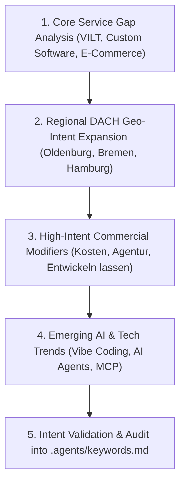

# 🎯 Continuous Keyword Intelligence & Refresh Skill

> [!info] Objective & Scope
> This skill executes recurring discovery, evaluation, and enrichment of high-intent SEO keywords. It directly maintains and enriches the Single Source of Truth at `[[.agents/keywords.md]]`, ensuring that blog articles, landing pages, and programmatic SEO hubs continuously target high-demand, conversion-focused search terms across DACH (Germany, Austria, Switzerland) and international markets.
>
> Source Workflow: `content/conductor/keyword-refresh-workflow.md`

---

## 📍 Core Knowledge Bases & SSOT References

| Resource | File Path | Purpose |
|---|---|---|
| **Active Keyword SSOT** | `[[.agents/keywords.md]]` | Single Source of Truth for all active target keywords, search volumes, and competition tiers. |
| **Brand & Local Geography SSOT** | `[[brand.json]]` | Business headquarters (Oldenburg), service radius, target cities, and localized SEO keyword sets. |
| **Strategic Narrative SSOT** | `[[.agents/product-marketing.md]]` | Core service pillars, buyer personas, pain points, and customer vocabulary matrix. |
| **Conductor Master Workflow** | `content/conductor/keyword-refresh-workflow.md` | Master workflow reference and guidelines. |
| **Optimization Backlog** | `content/conductor/blog-optimization-backlog.md` | Master tracking of articles aligned to target keywords. |

---

## 🔄 The 5-Pillar Keyword Discovery Engine

Whenever this skill executes, evaluate candidate queries across the 5 core discovery pillars:

### 1. Core Service Gap Analysis
Cross-reference existing sections in `[[.agents/keywords.md]]` against actual service deliverables:
- **VILT Stack & Modern Web Engineering:** Laravel 12, Inertia.js v2, Vue 3, Tailwind CSS v4.
- **Shopify & Headless E-Commerce:** Shopify Plus migrations, headless storefronts, speed optimization.
- **Enterprise Workflow Automation:** n8n, Zapier, custom API integration, MCP server development.
- **Fractional CTO & Architecture Audits:** Codebase refactoring, performance profiling, security audits.

### 2. Regional DACH Geo-Intent Expansion
Generate high-converting location pairs combining target cities from `[[brand.json]]` with high-value service roots:
- **Target Cities:** Oldenburg, Bremen, Hamburg, Hannover, Münster, Osnabrück, Bielefeld, Wilhelmshaven, Cloppenburg, Emden, Leer, Nordenham, Rastede, Buxtehude.
- **Example Patterns:** `[Service Root] + [City]` $\rightarrow$ `Individualsoftware Entwicklung Bremen`, `Headless E-Commerce Agentur Hamburg`, `App Entwickler Oldenburg`, `Webdesign Agentur Oldenburg`.

### 3. Intent-Driven Commercial Modifiers (BOFU Focus)
Filter for Bottom-of-Funnel (BOFU) purchase intent queries by attaching transactional modifiers:
- **Agency Search:** `[Term] + Agentur Deutschland / Dienstleister / Partner`
- **Cost & Feasibility:** `[Term] + Kosten / Preise / Aufwand berechnen`
- **Commissioning:** `[Term] + entwickeln lassen / programmieren lassen / mieten`
- **Comparisons:** `[Tech A] vs [Tech B] für Unternehmen / Vor- und Nachteile`

### 4. Emerging AI & Developer Tooling Trends
Capture trending technological paradigm shifts before competitors:
- **AI Agents & Tool Use:** `Model Context Protocol (MCP)`, `Cursor AI Workflow`, `OpenClaw Automation`, `AI Agents Business Workflow`.
- **Next-Gen Frameworks:** `Inertia v2 Features`, `Tailwind v4 Migration`, `PHP 8.5 Performance`, `Laravel 12 Architecture`.

### 5. Validation & Deduplication Protocol
- **Search Volume & Intent Rating:** Assign estimated Monthly Search Volume, Volume Tier (*High/Medium/Low*), and Competition Score.
- **Cannibalization Check:** Ensure new terms do not duplicate existing keywords in `keywords.md` or existing published blogs.

---

## 📋 Execution Protocol (Step-by-Step)

1. **Step 1: Ingest Current Baseline**
   - Read `[[.agents/keywords.md]]` to map out under-represented categories or missing service/geo combinations.

2. **Step 2: Market Extraction & Keyword Identification**
   - Identify 10–25 fresh target queries matching the 5 pillars.
   - Categorize by intent: Informational (Top of Funnel), Commercial Investigation (Middle of Funnel), Transactional (Bottom of Funnel / BOFU).

3. **Step 3: Update `keywords.md` SSOT**
   - Insert new keywords under their relevant thematic section (or create a new sub-category table).
   - Format tables strictly with: `| S.no | Keyword | Search Volume | Volume | Competition |`.
   - Update the `Last Updated: YYYY-MM-DD` date at the top of `[[.agents/keywords.md]]`.

4. **Step 4: Update Backlog Alignment**
   - Cross-link any newly discovered high-potential keywords to pending articles in `[[content/conductor/blog-optimization-backlog.md]]`.

---

> [!tip] Continuous Optimization Rule
> ==Always prioritize high-commercial-intent keywords (BOFU) with medium volume over vanity keywords with high volume and zero purchase intent.== 50 monthly searches from business owners ready to hire an agency are 100x more valuable than 10,000 generic student searches.
