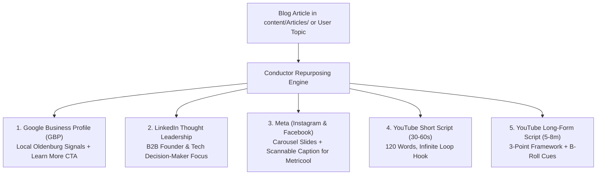

# 🚀 Social Media & Google Business Profile (GBP) Repurposing Skill

> [!summary] Objective & Distribution Architecture
> When a new blog post is created or optimized in `content/Articles/` (or when given a business topic), this skill extracts core hooks, actionable takeaways, and engineering insights to generate a complete multi-platform distribution package ready for **Metricool scheduling**, **Google Business Profile**, and **YouTube video recording** in under 5 minutes.
>
> Master Workflow Source: `content/conductor/blog-to-social-youtube-workflow.md`

---

## 🗺️ Multi-Platform Distribution Overview



---

## 📋 The 5 Distribution Output Templates

Whenever this skill is triggered, produce clean, copy-pasteable Markdown blocks formatted for each destination:

---

### 1. Google Business Profile (GBP) "What's New" Update

- **Target Length:** 100–150 words.
- **Objective:** Drive local DACH clicks to `masrisystems.com/blog/[slug]` and reinforce local search authority in **Oldenburg / Bremen / Niedersachsen**.
- **Template Structure:**
  ```markdown
  ### 📍 Google Business Profile (GBP) Post

  **Headline:** [Punchy 1-line business benefit / hook]

  [1-sentence overview of the problem and modern solution]

  **Key Highlights:**
  - 🔹 [Takeaway 1 - practical business or technical impact]
  - 🔹 [Takeaway 2 - time, cost, or performance efficiency]
  - 🔹 [Takeaway 3 - competitive advantage]

  🏢 *Entwickelt von Masri Systems – Ihr Partner für individuelle Softwareentwicklung, Webdesign & KI-Automatisierung in Oldenburg & Bremen.*

  🔗 **Call-to-Action Button:** Jetzt lesen → `https://masrisystems.com/blog/[slug]`
  ```

---

### 2. LinkedIn Thought Leadership Post

- **Target Audience:** CTOs, technical founders, product managers, and software engineers.
- **Style:** Mobile-scannable (1–2 line paragraphs), zero corporate buzzwords, strong pattern interrupt.
- **Template Structure:**
  ```markdown
  ### 💼 LinkedIn Post

  [Pattern-Interrupt Hook — Provocative statement or counter-intuitive metric]

  [Short 1-2 sentence context establishing the common mistake or engineering bottleneck]

  Here is what we implemented at Masri Systems:

  1️⃣ **[Core Principle 1]**: [Brief explanation]
  2️⃣ **[Core Principle 2]**: [Brief explanation]
  3️⃣ **[Core Principle 3]**: [Brief explanation]

  **The Takeaway:**
  [1-2 sentences summarizing the architectural or business shift]

  What is your team's current approach to [Topic]? Let's discuss in the comments below. 👇

  #SoftwareDevelopment #TechLeadership #MasriSystems #WebDevelopment #Automation
  ```

---

### 3. Meta Package (Instagram & Facebook via Metricool)

- **Instagram Carousel Storyboard (5–7 Slides):**
  ```markdown
  ### 📸 Instagram Carousel (Metricool)

  - **Slide 1 (Hook):** [High-contrast bold title + subtitle]
  - **Slide 2 (The Problem):** [The invisible cost of doing it the old way]
  - **Slide 3 (Pillar 1):** [Actionable takeaway #1 with bold highlight]
  - **Slide 4 (Pillar 2):** [Actionable takeaway #2 with bold highlight]
  - **Slide 5 (Pillar 3):** [Actionable takeaway #3 with bold highlight]
  - **Slide 6 (Architecture / Summary):** [Comparison table or quick checklist]
  - **Slide 7 (CTA):** [Save this post 📌 & link in bio for full article]

  **Instagram Caption:**
  [Hook sentence]
  ---
  [3 bullet breakdown of the core insights]
  ---
  👉 Full breakdown on masrisystems.com/blog
  📌 Save this post for your next architecture review!

  #MasriSystems #WebDesign #SoftwareEngineering #Automation #TechTips #Developers #VILTStack
  ```

- **Facebook Post:**
  ```markdown
  ### 📘 Facebook Page Post

  [Engaging 2-3 paragraph link preview copy leading into the article URL with clear CTA]
  ```

---

### 4. YouTube Short Script (30–60 Seconds / ~120 Words)

- **Objective:** Maximum viewer retention, high completion rate, and seamless infinite looping.
- **Template Structure:**
  ```markdown
  ### 🎬 YouTube Short Script (Vertical 9:16)

  **Estimated Duration:** 45 seconds (~120 words)

  | Timestamp | Visual Cue / Screencast | Spoken Audio |
  |---|---|---|
  | `0:00 - 0:03` | *[Zoom in on error/code/headline]* | "If you're still doing [Common Mistake], you're wasting hours of development time." |
  | `0:03 - 0:10` | *[Cut to fast code scrolling]* | "Here's why traditional approaches fail under load..." |
  | `0:10 - 0:35` | *[Show 3 quick visual bullet cards]* | "First, [Step 1]. Second, [Step 2]. And third, [Step 3]." |
  | `0:35 - 0:45` | *[Show final clean dashboard/result]* | "And that is exactly why..." *(Sentence flows smoothly back into the opening hook for infinite loop)* |
  ```

---

### 5. YouTube Long-Form Script (5–8 Minutes / 3-Point Framework)

- **Objective:** High retention, clear chapter markers, actionable coding/architecture screencast.
- **Template Structure:**
  ```markdown
  ### 🎥 YouTube Long-Form Script (Horizontal 16:9)

  **Working Title:** [SEO-optimized title containing primary keyword]

  - **00:00 - The Click Confirmation:** Validate the title immediately. State problem & teaser for Point #3.
  - **00:45 - Context Bridge:** Why the default approach breaks at scale.
  - **01:30 - Point 1: The Architectural Foundation:** Walkthrough with screen recording.
  - **03:30 - Point 2: The Core Automation Engine:** Common pitfalls to avoid + soft subscribe reminder.
  - **05:15 - Point 3: The High-Leverage Implementation:** Deliver the core value / secret tip.
  - **06:45 - Next Steps & Video Bridge:** Direct bridge to next related video card (no "in conclusion").
  ```

---

## ⚡ Execution Protocol

When user asks for social media, GBP, or Metricool posts:
1. Identify the source article in `content/Articles/` (or user's provided topic).
2. Extract the primary keyword, key takeaways, and local anchors.
3. Output the 5 formatted packages above cleanly so they are instantly ready to schedule or record.
