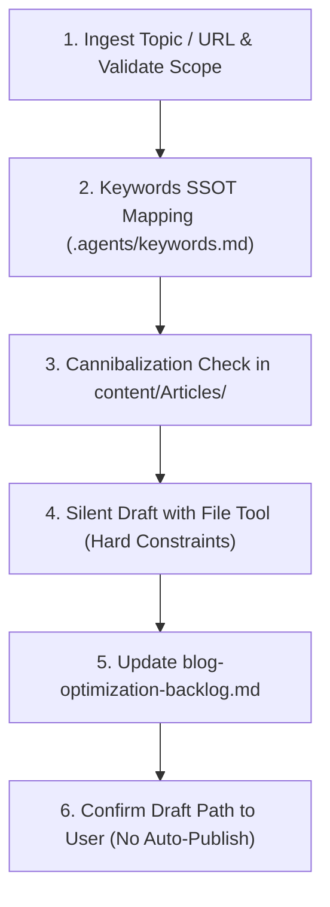

# Weekly Blog Generation & Optimization Skill

> [!important] Hard Principle: Draft for Review Only (Never Auto-Publish)
> Your task is to interactively draft a weekly blog post for **review** — not to publish it automatically. Always save with `draft: true` and `status: draft`.
>
> Master Workflow Source: `content/conductor/weekly-blog-workflow.md`

---

## 🎯 Content Scope

This blog is a business channel for [masri.blog](https://masri.blog) / [masrisystems.com/blog](https://masrisystems.com/blog) and exists to drive SEO traffic and qualified leads for **Masri Systems**.

**In Scope:**
- Custom software development & system integration (VILT Stack: Laravel 12, Inertia v2, Vue 3, Tailwind v4)
- Website design & development (starter, growth, enterprise tiers, conversion landing pages)
- E-commerce / online shop development (Shopify Plus, headless)
- Mobile application development
- Hosting & website care / maintenance
- Consulting & strategy, industry niches
- AI workflows, MCP server development, business process automation

**Out of Scope:**
- Personal notes, unrelated hobbies, anything not connected to a Masri Systems service or software/business space. If a suggested topic doesn't fit, ask the user to reframe.

**Topic Ingestion Modes:**
1. **Freeform topic:** User describes what to write about (optionally with raw notes/audio).
2. **Reference mode:** User pastes a URL to an article. Fetch it, extract core ideas, and write an **original** Masri Systems-voiced post covering the subject from your own angle. Never reproduce more than a short quote (<15 words). Credit source if directly referenced.

---

## 📋 Step-by-Step Execution Pipeline



### 1. Ingest Topic & Process Inputs
- Confirm topic fits the Content Scope above.
- If a reference URL was given, extract core ideas into concept-only bullet points.
- Identify primary angle tailored to technical founders, CTOs, and business decision-makers.

### 2. Keywords Allocation from SSOT
- Load `[[.agents/keywords.md]]`.
- **Keyword Allocation:** **1 prime target keyword** + **6 medium-to-high competition secondary keywords with high search volume**.
- **Paragraph Focus:** Focus on **1 keyword per paragraph** for natural contextual flow.
- **Keyword Density:** Maintain **0.5–1.5% keyword density** (`Number of keywords / Total word count`).

### 3. Cannibalization Check
- Search `content/Articles/**/*.md` for existing articles covering the same topic or targeting the same `target_keyword`.
- If a duplicate/close match exists, halt and ask the user whether to (a) update/expand the existing article, or (b) draft a new post with a distinctly different angle and target keyword.

### 4. Drafting Rules & Hard Constraints (SILENT GENERATION)

Do NOT output the raw post text into the chat. Generate internally and use the file writing tool to create the draft.

- **Length Cap:** Strictly under **1,000 words total** (body copy, excluding frontmatter/FAQ).
- **SEO-Optimized Filename:** Clean, lowercase kebab-case containing the prime keyword (e.g., `ai-video-automation-workflow.md`, `laravel-inertia-performance.md`).
- **Brand & Author:** Always set `author: "Masri Systems"`. **NEVER** use "Mohamad Masri".
- **Zero Redundant H1:** The page header automatically renders the frontmatter `title:` as the page `<h1>`. Therefore, **do NOT repeat `# Title` in the markdown body**.
- **Hero Image & Nano Banana Generation Pipeline:**
  - Must be the **very first element** immediately following the closing `---` of the frontmatter.
  - **Generation:** Load `content/private/Prompts/Images/Blog Hero Image Prompt (Nano Banana 16-9).md` and generate a 16:9 widescreen concept using Nano Banana.
  - **Optimization:** Run the `optimize image` (`image-webp-geotag`) skill:
    1. Convert to `.webp` (`1200x675`, 16:9, quality 85).
    2. Rename to `masrisystems-[subfolder]-[target-keyword]-oldenburg.webp`.
    3. Geotag with Oldenburg coordinates (`53.136829, 8.196328`) & embed IPTC/EXIF metadata from `brand.json`.
    4. Save to `content/Assets/Blog/` and `public/images/`.
  - **Fallback:** Use tested Unsplash image parameterized with `?auto=format&fit=crop&w=1200&h=675&q=80` with attribution links in footer.
- **Obsidian Callouts & AI SEO Structure:**
  - Starts immediately after hero image with `> [!summary] TL;DR` definition block (40–60 words).
  - Clean `##` and `###` section hierarchy with Table of Contents.
  - `> [!tip]` callouts for extractability by AI search engines (Google AI Overviews, Perplexity).
  - Structured FAQ section (3 Q&As) before footer.
- **Verified Internal Wikilinks:** Include 2–3 wikilinks to **genuinely existing** vault notes or services (e.g., `[[Clean Architecture]]`, `[[Software Development]]`, `[[brand.json]]`). Never create broken 404 links.
- **`untell` Anti-AI Humanization Rules:**
  - **Banned AI Clichés:** *delve into, tapestry, revolutionize, in today's fast-paced world, game-changer, unleash, it's worth noting, pivotal, seamlessly, furthermore, moreover, holistic, testament*.
  - **Burstiness & Rhythm:** Alternate punchy 3–6 word sentences with compound technical explanations.
  - **Engineering Grounding:** Ground arguments in real engineering constraints (API rate limits, memory overhead, hosting cost, bundle size).
- **Mermaid.js Diagram:** Include one flowchart only if it genuinely clarifies a complex process. Never emit an empty mermaid block.
- **5 Related Hashtags:** Add 5 consistent hashtags below footer attributions (e.g. `#MasriSystems #WebDesign #SoftwareDevelopment #TechInnovation #SEO`).

### 5. Exact Frontmatter Specification

```yaml
---
title: "Engaging Title Containing the Prime Keyword"
meta_description: "Max 155 characters, CTR-optimized summary."
target_keyword: "prime keyword"
tags:
  - coding/ai
  - web-development
  - automation
author: "Masri Systems"
created: YYYY-MM-DD
updated: YYYY-MM-DD
draft: true
status: draft
subfolder: "ai"
aliases:
  - Short Alt Title
---
```

> [!warning] Critical YAML Frontmatter Rules
> 1. **Both `draft: true` and `status: draft` are required.** Quartz withheld filter checks `draft: true`.
> 2. **NEVER prefix YAML tags with `#`.** Write `- coding/ai`, NOT `- #coding/ai` (a hash after space creates a YAML comment and strips all tags).

### 6. File Save Location

Save draft directly to:
`content/Articles/[Category]/[Subfolder]/[keyword-slug].md`

**Approved Categories:**
- `Coding/AI` — AI agents, LLM tooling, automated workflows
- `Coding/Backend` — APIs, servers, databases, Laravel/PHP
- `Coding/Frontend` — UI/UX, Vue/React, Tailwind, design systems
- `Coding/E-commerce` — Online stores, checkout, conversion
- `Coding/SEO` — Technical and content SEO strategies
- `Coding/Tools` — Developer tooling, productivity software
- `Business` — Services, agency strategy, pricing, positioning

*(Never save under Personal, Trading, German, or kuraan).*

### 7. Synchronize Master Backlog & Confirm
1. Update `content/conductor/blog-optimization-backlog.md` (mark row status as `✅ Optimized` and update summary counts).
2. Confirm to user in chat:
   > *"The draft blog post '[Topic]' has been written to `[Path]` with `draft: true`. It is safely gated and NOT published. Please review it whenever you're ready."*
